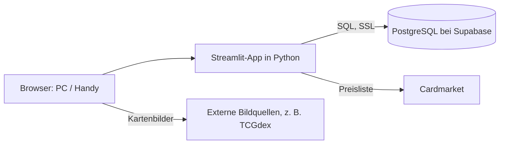

# Pokémon-Sammlung

Web-App, mit der ich eine Sammlung aus Pokémon-Karten und versiegelten Produkten verwalte: Bestand, Preise,
Wertverlauf und Vollständigkeit der Sets. Sie läuft am PC und am Handy.

> **Entstehung:** Die App ist mit Unterstützung eines KI-Assistenten (Claude) entstanden. Ich nutze sie als
> Lernprojekt während meiner Umschulung zum Fachinformatiker für Digitale Vernetzung.

## Funktionen
- Übersicht mit Gesamtwert, Gewinn/Verlust bei Produkten und Wertverlauf (Beträge lassen sich ausblenden)
- Karten und versiegelte Produkte erfassen, einzeln oder mehrere auf einmal
- Suche über Sammlung und Kartenkatalog
- Anzeige, welche Karten eines Sets noch fehlen
- Preise aus der öffentlichen Preisliste von Cardmarket, bei Bedarf eigene Preise
- Export als Excel-Datei
- Eigene Ansicht fürs Handy

## Aufbau



**Technik:** Python, Streamlit, PostgreSQL, pandas, Altair

| Datei | Aufgabe |
|---|---|
| `app.py` | Startdatei: Seitenaufbau, Menü, globale Suche |
| `db.py` | Verbindungspool, Abfragen mit Zwischenspeicher, Transaktionen |
| `katalog.py`, `produktkatalog.py` | Karten- und Produktsuche |
| `preise.py` | Preisliste laden und speichern |
| `bilder.py` | Bildadressen und Vorschaubilder |
| `design.py`, `bausteine.py` | Aussehen und gemeinsame Bausteine |
| `ansichten/` | eine Datei pro Menüpunkt |
| `datenbank/schema.sql` | Tabellen, Schlüssel und Indizes |
| `datenbank/abfragen.sql` | kommentierte Beispielabfragen |

## Datenbank
Ausführlich mit ER-Diagramm, Entwurfsentscheidungen und Beispielabfragen: **[docs/datenbank.md](docs/datenbank.md)**

- Stammdaten (`sets`, `karten`, `produkte`) sind vom Besitz (`sammlung_karten`, `sammlung_produkte`) getrennt.
- Der Preisverlauf liegt in `preis_karten` und `preis_produkte`, ein Eintrag pro Tag.
- Der neueste Preis wird per `LEFT JOIN LATERAL` gelesen, Aktualisierungen laufen über `ON CONFLICT`.
- Row Level Security ist für die Sammlungs- und Katalogtabellen eingeschaltet. Damit sind sie über die
  Web-Schnittstelle von Supabase gesperrt. Die App verbindet sich direkt mit der Datenbank.

## Starten
Voraussetzungen: Python 3.11 oder neuer und eine leere PostgreSQL-Datenbank.

1. `datenbank/schema.sql` in der Datenbank ausführen.
2. `.streamlit/secrets.toml.example` als `.streamlit/secrets.toml` kopieren und die eigenen Zugangsdaten eintragen.
3. Pakete installieren und starten:

```
pip install -r requirements.txt
streamlit run app.py
```

Die Datenbank ist am Anfang leer. Der Kartenkatalog und meine Sammlung sind nicht Teil des Repositorys.

## Sicherheit und Grenzen
- Zugangsdaten stehen nur in `secrets.toml` bzw. in den Secrets der Hosting-Plattform, nie im Code.
- Die App hat **keine eigene Anmeldung**. Sie sollte nur privat oder hinter einem Zugriffsschutz laufen.
- Bei einem Verbindungsfehler zeigt die App die Fehlermeldung der Datenbank an.
- Ein Beispiel für ein wöchentliches Backup liegt in `docs/backup-workflow.beispiel.yml` (nur für private Repositorys).

## Hinweis
Privates, nicht kommerzielles Projekt. Es steht in keiner Verbindung zu Nintendo, The Pokémon Company oder
Cardmarket. Pokémon ist eine Marke der jeweiligen Rechteinhaber. Das Repository enthält keine Kartenbilder.
