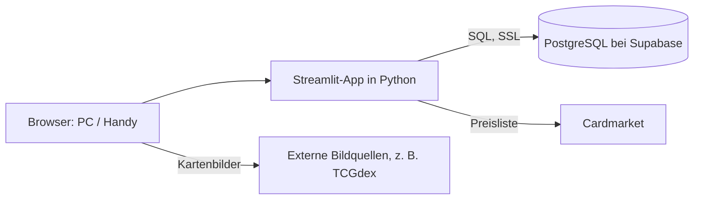

# Pokémon-Sammlung

Ich sammle Pokémon-Karten und versiegelte Produkte. Irgendwann war die Excel-Liste zu
unübersichtlich, also gibt es jetzt diese Web-App. Sie zeigt, was ich habe, was es ungefähr wert ist und welche
Karten in einem Set noch fehlen. Die Preise kommen jeden Tag automatisch dazu. Die App läuft im Browser am PC und
am Handy.

**Zur Entstehung:** Den Python-Code hat größtenteils ein KI-Assistent (Claude) geschrieben. Ich habe festgelegt,
was die App können soll, sie im Alltag getestet und mit der Datenbank in DBeaver gearbeitet. Mich interessiert vor
allem der Datenbank-Teil, der ist hier ausführlicher beschrieben: [docs/datenbank.md](docs/datenbank.md).

## Was die App kann
- Gesamtwert, Gewinn oder Verlust bei Produkten und ein Wertverlauf (Beträge lassen sich ausblenden)
- Karten und Produkte eintragen, auch mehrere auf einmal
- Suche über die Sammlung und einen Kartenkatalog
- Anzeige, was in einem Set noch fehlt
- Preise aus der öffentlichen Preisliste von Cardmarket, bei Bedarf eigene Preise
- Export als Excel-Datei

## Aufbau



Technik: Python, Streamlit, PostgreSQL, pandas

| Datei | Aufgabe |
|---|---|
| `app.py` | Startdatei mit Menü und Suche |
| `db.py` | Verbindung zur Datenbank, Lesen und Schreiben |
| `katalog.py`, `produktkatalog.py` | Karten- und Produktsuche |
| `preise.py` | Preisliste laden und speichern |
| `ansichten/` | eine Datei pro Menüpunkt |
| `datenbank/schema.sql` | Tabellen, Schlüssel, Indizes |
| `datenbank/abfragen.sql` | ein paar kommentierte Beispielabfragen |

## Selbst starten
Man braucht Python 3.11 oder neuer und eine leere PostgreSQL-Datenbank.

1. `datenbank/schema.sql` in der Datenbank ausführen.
2. `.streamlit/secrets.toml.example` nach `.streamlit/secrets.toml` kopieren und die eigenen Zugangsdaten eintragen.
3. Pakete installieren und starten:

```
pip install -r requirements.txt
streamlit run app.py
```

Die Datenbank ist danach leer. Meine Sammlung und der Kartenkatalog sind nicht im Repository.

## Gut zu wissen
- Die Zugangsdaten stehen nie im Code, nur in `secrets.toml` bzw. bei der Hosting-Plattform.
- Die App hat keine eigene Anmeldung. Sie läuft bei mir als private App und sollte nicht offen im Internet stehen.
- Ein Beispiel für ein wöchentliches Datenbank-Backup mit GitHub Actions liegt in
  `docs/backup-workflow.beispiel.yml`. Das gehört nur in ein privates Repository.

Privates Hobbyprojekt ohne Verbindung zu Nintendo, The Pokémon Company oder Cardmarket. Es sind keine Kartenbilder
enthalten.
