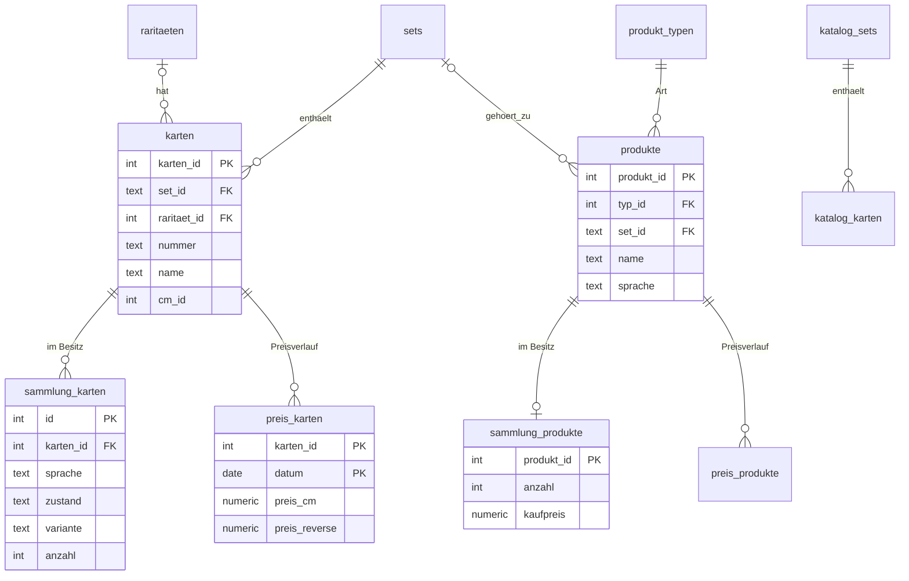

# Datenbank

PostgreSQL bei Supabase. Die vollständige Struktur steht in [`../datenbank/schema.sql`](../datenbank/schema.sql),
Beispielabfragen in [`../datenbank/abfragen.sql`](../datenbank/abfragen.sql).

## Datenmodell

Nicht alle Spalten sind dargestellt.

## Entwurfsentscheidungen

| Entscheidung | Grund |
|---|---|
| **Stammdaten getrennt vom Besitz** (`karten` und `sammlung_karten`) | Eine Karte existiert unabhängig davon, ob und wie oft ich sie habe. Dieselbe Karte kann in mehreren Sprachen, Zuständen und Varianten im Besitz sein. |
| **Preisverlauf als eigene Tabelle**, Schlüssel `(karten_id, datum)` | Ein Preis pro Karte und Tag. So entsteht eine Historie, und ein zweiter Import am selben Tag überschreibt nur. |
| **Kartennummer als Text** | Nummern wie `025/165` oder `SV001` sind keine Zahlen. |
| **Auswahllisten als eigene Tabellen** (`raritaeten`, `produkt_typen`) | Keine Tippfehler, und die UVP hängt an der Produktart. |
| **Katalog ohne Fremdschlüssel zur Sammlung** | Der Katalog wird von außen neu geladen. Eine lose Verknüpfung verhindert, dass ein Neuladen an Fremdschlüsseln scheitert. |

Das entspricht im Kern der **3. Normalform**: Jede Information steht an einer Stelle. Der Preis einer Karte
steht nicht in jeder Besitzzeile, sondern einmal je Tag in `preis_karten`.

## Regeln in der Datenbank
Die Datenbank prüft selbst, nicht nur die App:

| Regel | Beispiel |
|---|---|
| Primärschlüssel | `karten.karten_id`, zusammengesetzt bei `preis_karten (karten_id, datum)` |
| Fremdschlüssel | `sammlung_karten.karten_id` → `karten` |
| `UNIQUE` | dieselbe Karte nur einmal je Sprache, Zustand und Variante |
| `CHECK` | nur erlaubte Sprachen, Zustände, Varianten; `anzahl > 0` |
| Index | auf Fremdschlüsseln und für die Namenssuche (`lower(name_de)`) |

## Abfragen

| Technik | Wofür in der App |
|---|---|
| `LEFT JOIN LATERAL ... LIMIT 1` | den jeweils neuesten Preis zu jeder Karte |
| Fensterfunktion `ROW_NUMBER() OVER (PARTITION BY ...)` | Preisänderungen zwischen den letzten beiden Ständen |
| `WITH` (CTE) | lange Abfragen in lesbare Schritte teilen |
| `GROUP BY`, `SUM`, `COALESCE` | Wert je Set, Gewinn mit Kaufpreis oder ersatzweise UVP |
| `INSERT ... ON CONFLICT DO UPDATE` | Karte hinzufügen oder Anzahl erhöhen in einem Schritt |
| Transaktionen | mehrere Änderungen ganz oder gar nicht speichern |

Die Abfragen in `abfragen.sql` wurden gegen eine leere Datenbank mit dem Schema und erfundenen Testdaten
ausgeführt.

## Betrieb und Sicherheit
- **Zugangsdaten** nur in den Secrets der Hosting-Plattform bzw. in einer lokalen, nicht versionierten Datei
- **Row Level Security** sperrt die Tabellen für die öffentliche Web-Schnittstelle von Supabase. Die App
  verbindet sich direkt über PostgreSQL.
- **Verbindungspool**, damit nicht jede Abfrage eine neue, langsame Verbindung aufbaut
- **Zwischenspeicher**: Lesende Abfragen werden gecacht, nach jeder Änderung wird der Cache geleert
- **Backup**: wöchentlich per `pg_dump` (Beispiel in [`backup-workflow.beispiel.yml`](backup-workflow.beispiel.yml))
- **Preise**: täglicher Import aus einer öffentlichen Preisliste per Upsert
- Werkzeuge: DBeaver für Abfragen und Strukturänderungen
